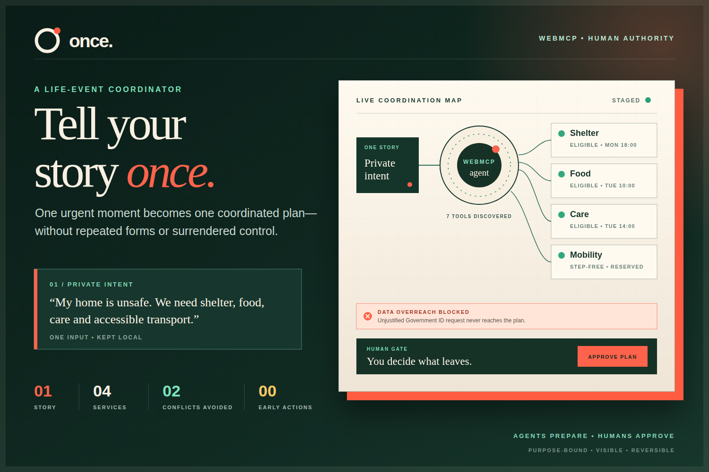

# ONCE — Tell Your Story Once



[Open the live WebMCP demo](https://once-story.vercel.app/) · [Read the validation evidence](docs/VALIDATION.md)

A WebMCP-native life-event coordination workspace for navigating fragmented support without repeating the same sensitive story across forms. A person tells an agent about one urgent event once; the agent projects that story into reversible planning constraints, discovers four fictional provider simulations, applies deterministic eligibility rules, removes schedule conflicts, and stages one coordinated plan. The page shows exactly what each provider would receive. Nothing is committed until the person approves the exact fingerprinted proposal.

The staged state makes the outcome inspectable at a glance: one story, four coordinated services, two avoided conflicts, one blocked overreach, and zero applications sent before approval. The same structured outcome is returned to the agent by `prepare_assistance_plan`; it is not a presentation-only counter.

This is an honest, local-first working demonstration. Providers, records, applications, and receipts are synthetic. It does not contact real agencies or offer medical, legal, or eligibility advice.

## Try the agent journey

Open the app in a WebMCP-capable browser and ask:

> My home is unsafe. I am one adult with three children in East Quarter, and we need temporary shelter, food, a family health check, and step-free transport within 72 hours. Our monthly income is $1,100 and we speak Arabic and English. Turn this one story into a safe coordinated plan. Do not submit anything.

The agent should update the local constraints, discover and inspect the simulated network, and stage four applications. The page will show one blocked Government ID request and keep the commit tool unavailable. Open the disclosure review and approve in the page; only then ask the agent to commit the approved plan.

## Why this problem matters

The [OECD's 2024 review of access to social protection](https://www.oecd.org/en/publications/modernising-access-to-social-protection_af31746d-en.html) identifies complex information and cumbersome application procedures as barriers that prevent eligible people from receiving support. Government service guidance likewise recommends that services avoid asking people to re-enter information, collect only what is needed, explain why each field is required, and obtain specific consent for different uses:

- [GOV.UK: collecting personal information](https://www.gov.uk/service-manual/design/collecting-personal-information-from-users)
- [GOV.UK: structuring forms](https://www.gov.uk/service-manual/design/form-structure)
- [GOV.UK: securing personal data](https://www.gov.uk/guidance/principles-for-securing-personal-data-in-government-services)

## Why WebMCP is essential

DOM clicking can fill one form, but it does not give an agent a stable, typed contract for comparing several services, inspecting their data requests, staging a shared plan, and respecting a human approval boundary. This demonstration exposes that contract through the WebMCP Imperative API:

| Tool | Phase | Effect |
| --- | --- | --- |
| `get_private_intent` | Always | Returns the approved synthetic constraints used for planning |
| `discover_service_network` | Always | Discovers providers; returned provider text is marked untrusted |
| `check_service_eligibility` | Always | Runs deterministic rules for one or all programs |
| `inspect_data_requests` | Always | Separates purpose-bound fields from unjustified requests |
| `get_audit_trace` | Always | Returns the latest visible human/agent/system events |
| `update_planning_constraints` | Idle only | Projects the person's request into reversible, non-sensitive local constraints |
| `prepare_assistance_plan` | Idle only | Stages a conflict-free plan; submits nothing |
| `review_disclosures` | Planned/reviewing | Opens the visible human review |
| `commit_approved_plan` | Approved only | Consequential, single-use commit bound to the exact proposal |

Tools are re-registered as page state changes, so an agent cannot discover the commit capability before human approval. The update tool cannot accept Government ID or health notes and is removed after a plan is staged. Registration is cancelled with `AbortController` when the state changes or the page unmounts. Tool annotations use the current standard fields: `readOnlyHint` and `untrustedContentHint`.

ChatGPT's current site-tools implementation supports imperative tools registered with JavaScript in the top-level page, but not declarative form tools or tools inside iframes. This project deliberately uses that compatible path.

## What the agent uniquely adds

The visible buttons are an intentional progressive fallback: the experience remains usable in an ordinary browser and by people who prefer direct controls. The WebMCP path lets the agent translate one natural-language life event into validated constraints, then adds structured discovery, comparison, explanation, and composition across the four provider simulations. It can inspect eligibility and disclosure boundaries before staging a plan, while reusing the same state transitions and keeping the result visible to the person.

This repository simulates a service network inside one web app; it does not claim that four independent agencies are connected. The demonstration focuses on the browser-side collaboration and consent contract that independent services could adopt.

Existing care-navigation products validate the need for faster multi-service discovery and enrollment. This project's category is deliberately different: the civic journey is a concrete test case for a transferable consent boundary between a person, their chosen agent, and WebMCP-enabled sites.

## Trust model

- Data minimization: every requested field must have a declared purpose; the demo blocks a Government ID request that has none.
- Agent boundary: the chosen agent receives only the approved planning constraints; Government ID and health notes are excluded. Providers receive only purpose-approved fields after human approval.
- Prompt-injection boundary: provider notices are treated as untrusted. A deliberately bounded demo heuristic quarantines instruction-shaped content; it is not claimed as a general prompt-injection defense.
- Human authority: the agent can discover, check, compare, and stage. Only the visible page can approve or reject.
- Exact consent: approval is bound to a deterministic proposal fingerprint, expires after five minutes, and is consumed once.
- Honest cryptography claim: the fingerprint detects demo-state changes; it is not a cryptographic signature.
- Visible execution: the human journey, audit trail, fields shared, blocked fields, and receipts update in the page.

## Run locally

Requirements: Node.js 22+ and npm.

```bash
npm ci
npm run dev
```

Open `http://127.0.0.1:4178`. The visual journey works in ordinary browsers. To exercise actual WebMCP, use ChatGPT's in-app browser or Chrome 149+ with `chrome://flags/#enable-webmcp-testing` enabled. Local and deployment headers opt into origin isolation and restrict `tools` to the same origin.

## Verify

```bash
npm run check
npx playwright install chromium
npm run test:e2e
```

The suite contains deterministic domain tests, registration lifecycle tests, React journey tests, WCAG checks, and a real Chrome 151 WebMCP test that discovers and executes phase-aware tools. Evaluation prompts and expected tool sequences are in [`evals/webmcp-cases.json`](evals/webmcp-cases.json).

The production build also passes Lighthouse's WebMCP tool-registration and schema-validity audits, its agent accessibility-tree and `llms.txt` audits, and scores 98 Performance / 100 Accessibility / 100 Best Practices / 100 SEO in the reproducible local release environment. Exact evidence and limitations are recorded in [`docs/VALIDATION.md`](docs/VALIDATION.md).

GitHub Actions runs the same locked release gate on `main`, pull requests, and manual dispatch with read-only repository permissions.

## Project evidence

- [`docs/VALIDATION.md`](docs/VALIDATION.md) — reproducible release, coverage, browser, accessibility, dependency, and repository-hygiene evidence
- [`SECURITY.md`](SECURITY.md) — security boundaries and responsible disclosure
- [`THIRD_PARTY_NOTICES.md`](THIRD_PARTY_NOTICES.md) — direct dependency and asset licenses

## Official references

- [WebMCP Challenge resources](https://webmcp.devpost.com/resources)
- [WebMCP documentation](https://developer.chrome.com/docs/ai/webmcp)
- [Imperative API](https://developer.chrome.com/docs/ai/webmcp/imperative-api)
- [Security guidance](https://developer.chrome.com/docs/ai/webmcp/secure-tools)
- [Best practices](https://developer.chrome.com/docs/ai/webmcp/best-practices)
- [Evals guidance](https://developer.chrome.com/docs/ai/webmcp/evals)
- [Draft specification](https://webmachinelearning.github.io/webmcp/)

## License

MIT © 2026 Mohammed Shaibani.
